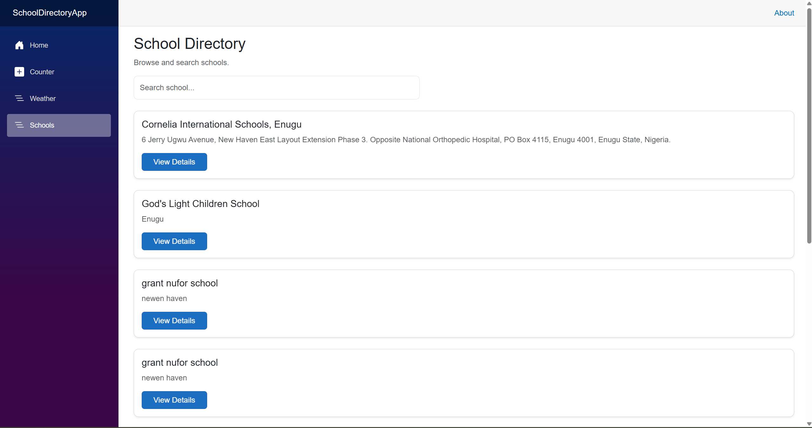
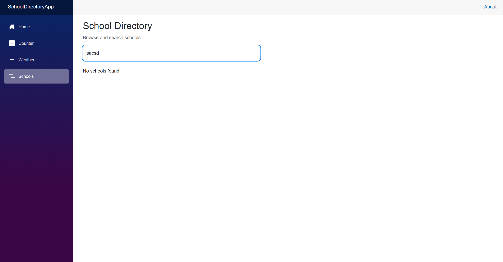
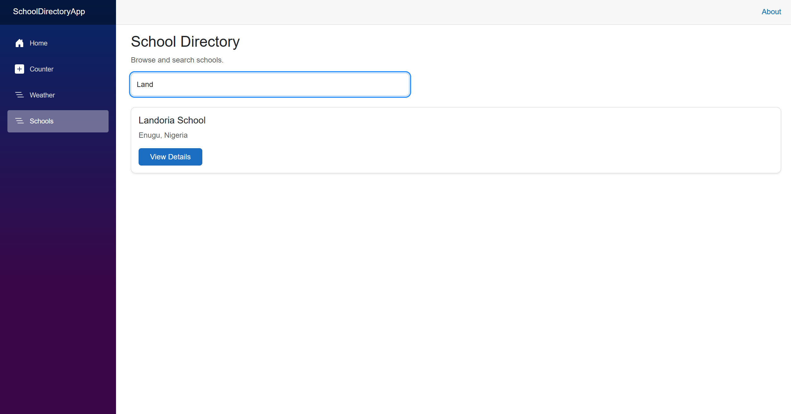
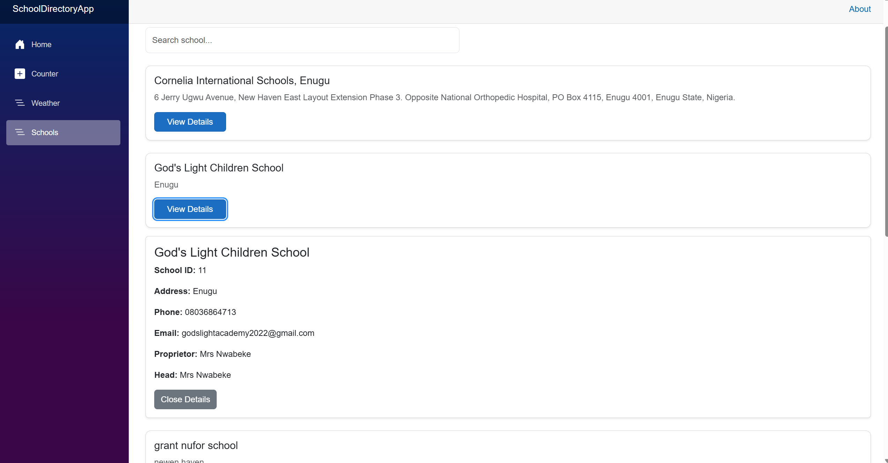
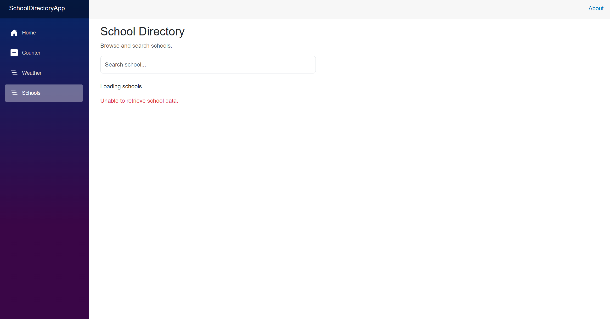
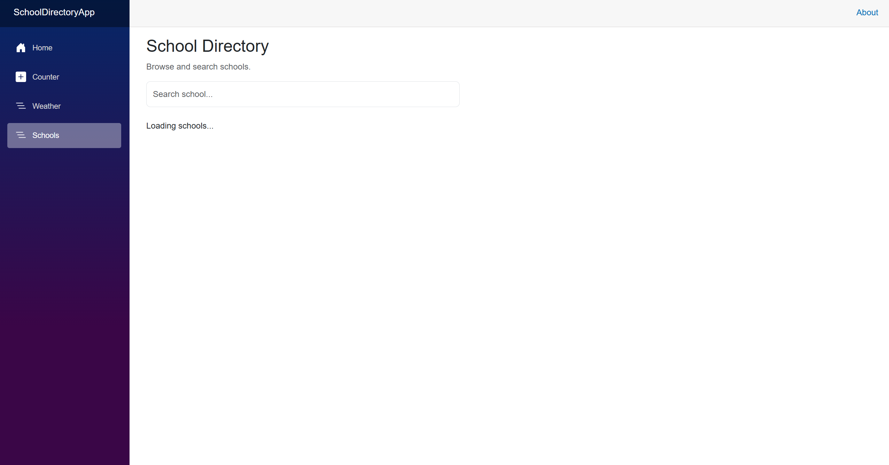

## School Directory App

A Blazor Web Application that retrieves school information from the Edutots School API and allows users to search schools and view their details.

## Technologies Used

- C#
- Blazor Web App (.NET 10)
- HTML and CSS
- Bootstrap
- HttpClient
- Edutots School API

## Features

- Retrieves school data from the Edutots School API.
- Displays school names and addresses.
- Allows users to search schools by name.
- Displays detailed information about a selected school.
- Includes loading and error messages.
- Allows users to close the school details panel.

## How to Run

1. Clone or download the repository.
2. Open the solution in Visual Studio.
3. Make sure the .NET 10 SDK is installed.
4. Run the application using Visual Studio.
5. Open the `/schools` page to view the School Directory.

## API

This application uses the Edutots School API to retrieve school information.

API endpoint: https://edutots.net/api/school

## Screenshots

Screenshots of the application will be added here.

### School List

### Search Results

### School Details

### Error State

### Loading State

